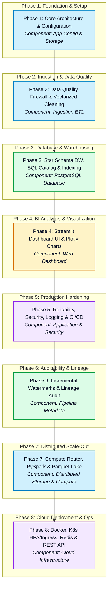

# 🚀 RetailLens – Master Architecture, Operations & Interview Guide

---

## 1. PROJECT MAP

The following Mermaid diagram maps the chronological progression of the 8 RetailLens engineering phases, highlighting the architectural component touched by each phase (ETL Ingestion, Database Data Warehouse, Web Analytics Dashboard, Infrastructure & Operations) and how subsequent phases build upon previous capabilities.



---

## 2. ARCHITECTURE

### System Component Architecture

```text
                  USERS / WEB CLIENTS / PROMETHEUS SCRAPERS
                                    │
                                    ▼
                Kubernetes Ingress (TLS SSL Termination)
                                    │
          ┌─────────────────────────┴─────────────────────────┐
          ▼                                                   ▼
Streamlit BI Web Dashboard (Port 8501)       Production REST API Boundary (Port 8000)
(app/main.py)                                 (api/app.py)
          │                                                   │
          └─────────────────────────┬─────────────────────────┘
                                    │
                                    ▼
              Analytics Application Service & Repository Layer
            (analytics/service.py & analytics/repository.py)
                                    │
       ┌────────────────────────────┼────────────────────────────┐
       ▼                            ▼                            ▼
Redis Cache Layer           Managed PostgreSQL          Prometheus Metrics Exporter
(analytics/cache.py)        (database/pool.py)          (analytics/metrics.py)
                                    ▲
                                    │ Batch Loading
              Modular Orchestrated Pipeline Engine
              (orchestration/pipeline.py & dag.py)
                                    │
            ┌───────────────────────┴───────────────────────┐
            ▼                                               ▼
Single-Node Pandas Transformer                 Distributed PySpark Transformer
(ingestion/transformer.py)                     (ingestion/spark_transformer.py)
            ▲                                               ▲
            └───────────────────────┬───────────────────────┘
                                    │ File-Size Routing (<100MB vs >=100MB)
                        Hybrid Compute Router
                     (ingestion/compute_router.py)
                                    │
                     Data Quality & Validation Firewall
                     (ingestion/validator.py & cleaner.py)
                                    │
                S3 / GCS Cloud Parquet Data Lake
                (storage/parquet_lake.py & cloud.py)
```

---

### Architectural Decision Records (ADR Chronology)

#### [Phase 1] ADR-001: Centralized Pydantic Environment Configuration Strategy
* **Context**: Need a secure, validated mechanism to manage environment settings across development, testing, and production.
* **Decision**: Implement `AppConfig` dataclass in [config/app_config.py](file:///c:/Users/priya/OneDrive/Desktop/RetailLens/config/app_config.py) loading environment variables dynamically via `python-dotenv`.
* **Rationale**: Prevents hardcoded credentials, enforces strict type checking and missing-variable detection before pipeline boot.
* **Status**: Implemented & Accepted.

#### [Phase 2] ADR-002: Vectorized Cleaning & Multi-Encoding Data Quality Firewall
* **Context**: Raw e-commerce CSV exports suffer from non-standard encodings (`ISO-8859-1`, `Windows-1252`), leading to `UnicodeDecodeError` crashes during ingestion.
* **Decision**: Implement `DataReader` with multi-encoding try-fallback loops and `DataValidator` / `DataCleaner` using vectorized Pandas string operations.
* **Rationale**: Vectorized regex replacements (`str.strip()`, `str.upper()`) run in C-level vectorized code (10-50x faster than Python `for` loops), while defensive multi-encoding checks guarantee ingestion resilience.
* **Status**: Implemented & Accepted.

#### [Phase 3] ADR-003: Star Schema Relational Data Warehouse & Indexing Strategy
* **Context**: Analytical SQL queries across large datasets require fast aggregation times without full table scans.
* **Decision**: Design a Kimball Star Schema with central `fact_sales` and dimension tables (`dim_customer`, `dim_product`). Add composite unique constraint `uq_fact_sales_natural_key(invoice_no, stock_code, invoice_timestamp)` and composite index `idx_fact_sales_year_month(invoice_year, invoice_month)`.
* **Rationale**: Enables Index-Only scans for date-ranged aggregation queries, eliminating table heap lookups and improving analytical query throughput.
* **Status**: Implemented & Accepted.

#### [Phase 4] ADR-004: Decoupled Streamlit Dashboard with Shared Service Caching
* **Context**: Streamlit re-executes the entire script on every user interaction, risking repeated slow DB queries.
* **Decision**: Implement `AnalyticsService` layer and cache service singletons using `@st.cache_resource` and dropdown data with `@st.cache_data(ttl=300)`.
* **Rationale**: Decouples presentation components from SQL execution, preventing redundant database roundtrips.
* **Status**: Implemented & Accepted.

#### [Phase 5] ADR-005: Security Hardening, Log Sanitization & Resilient Retries
* **Context**: Production environments require protection against log injection, path traversal, transient network failures, and credentials leaks.
* **Decision**: Implement `SensitiveDataFilter` in [config/logging_config.py](file:///c:/Users/priya/OneDrive/Desktop/RetailLens/config/logging_config.py), `retry_with_backoff` decorator in [database/retry.py](file:///c:/Users/priya/OneDrive/Desktop/RetailLens/database/retry.py), and path traversal guards.
* **Rationale**: Guarantees zero sensitive credential leakage in log streams while automatically recovering from transient database outages.
* **Status**: Implemented & Accepted.

#### [Phase 6] ADR-006: Incremental Watermarking, Pipeline Auditing & Lineage Provenance
* **Context**: Pipeline needs to prevent duplicate record processing across historical data loads while tracking exact data transformation lineage.
* **Decision**: Implement `IncrementalWatermarkManager` (using SHA-256/MD5 file hashes), `PipelineRunTracker` (writing to `pipeline_runs` table), and `DataLineageTracker` (writing to `data_lineage` table).
* **Rationale**: Ensures idempotent execution (skipping already-ingested files) and provides 100% auditability for data quality rates.
* **Status**: Implemented & Accepted.

#### [Phase 7] ADR-007: Scale-Out Compute Router, PySpark Engine & Parquet Data Lake
* **Context**: Large transaction datasets (>100MB / >2GB) overflow single-node RAM memory, causing Out-Of-Memory (OOM) crashes.
* **Decision**: Architect `ComputeRouter` in [ingestion/compute_router.py](file:///c:/Users/priya/OneDrive/Desktop/RetailLens/ingestion/compute_router.py) to dynamically route jobs by file size to `SparkDataTransformer` (PySpark Catalyst DAG) or `DataTransformer` (Pandas), and store output in Snappy-compressed Parquet partitioned by `year=YYYY/month=MM`.
* **Rationale**: Achieves zero-overhead single-node execution for standard files while leveraging Spark cluster parallelism for large exports.
* **Status**: Implemented & Accepted.

#### [Phase 8] ADR-008: Multi-Stage Containerization, Redis Caching, K8s Architecture & REST API
* **Context**: Requirements for cloud deployment, microservice API access, auto-scaling, and pr## 3. INTERVIEW-READY REFERENCE

### 1. Data Ingestion & Quality Firewall

#### Multi-Encoding Resilience
* **Definition:** The ability to read text files saved in different character encodings (like `ISO-8859-1` or `Windows-1252` instead of standard `UTF-8`) without throwing byte errors.
* **Why we used it in RetailLens:** Point-of-sale exports come from different international store systems and crash default CSV readers when foreign characters appear.
* **How we implemented it:** In [ingestion/ingestion.py](file:///c:/Users/priya/OneDrive/Desktop/RetailLens/ingestion/ingestion.py), `DataReader.read_csv()` loops through a fallback list (`["utf-8", "utf-8-sig", "iso-8859-1", "cp1252"]`) until the file opens cleanly.
* **🎯 Interview soundbite:** *"We added an automated encoding fallback loop in our ingestion reader so foreign character sets in POS exports never break the pipeline."*

#### Vectorized String Sanitization & Cleaning
* **Definition:** Running text cleaning operations across an entire column at once using fast C code under Pandas instead of slow Python `for` loops.
* **Why we used it in RetailLens:** Standard Python loops take minutes to clean 500,000 messy sales rows, while vectorized code finishes in milliseconds.
* **How we implemented it:** In [ingestion/cleaner.py](file:///c:/Users/priya/OneDrive/Desktop/RetailLens/ingestion/cleaner.py), `DataCleaner.clean()` applies vectorized methods (`str.strip()`, `str.upper()`, regex replacements) across product descriptions and customer IDs.
* **🎯 Interview soundbite:** *"We used Pandas vectorized string routines to sanitize raw product descriptions in C-speed batch operations instead of slow row-by-row Python loops."*

#### Multi-Stage Data Validation & Rule Firewall
* **Definition:** A two-part check that verifies data structure (column headers) first, then checks business rules (positive prices, valid dates) before data enters the database.
* **Why we used it in RetailLens:** Prevents malformed CSVs and corrupted rows from polluting PostgreSQL tables and breaking executive BI metrics.
* **How we implemented it:** In [ingestion/validator.py](file:///c:/Users/priya/OneDrive/Desktop/RetailLens/ingestion/validator.py), `DataValidator.validate()` checks required headers in Stage 1 and domain rules in Stage 2, outputting a structured `ValidationReport`.
* **🎯 Interview soundbite:** *"We built a two-stage validation firewall that enforces schema rules first and business logic second, routing bad rows away from database tables."*

#### Defensive Oversized File Guardrails
* **Definition:** A pre-check that inspects file size on disk before loading it into memory, stopping huge files early.
* **Why we used it in RetailLens:** Prevents giant or malicious multi-gigabyte uploads from overloading server RAM and causing out-of-memory (OOM) system crashes.
* **How we implemented it:** Implemented `validate_file_size()` in [ingestion/security.py](file:///c:/Users/priya/OneDrive/Desktop/RetailLens/ingestion/security.py) to raise a `SecurityValidationError` if `os.path.getsize()` exceeds `MAX_FILE_SIZE_MB` (100MB).
* **🎯 Interview soundbite:** *"We added pre-ingestion file size checks to reject oversized uploads before parsing, protecting application RAM from out-of-memory crashes."*

---

### 2. Distributed Scale-Out Data Engineering

#### Hybrid Compute Router
* **Definition:** A traffic controller script that checks file size before running ETL.
* **Why we used it in RetailLens:** Small files (<100MB) process faster in Pandas without Spark's slow startup time, while large files (>=100MB) need Spark so single-node RAM doesn't run out of memory (OOM).
* **How we implemented it:** In [ingestion/compute_router.py](file:///c:/Users/priya/OneDrive/Desktop/RetailLens/ingestion/compute_router.py), `ComputeRouter.select_engine()` checks `os.path.getsize()` against `SPARK_THRESHOLD_MB` (100MB) and returns either `SparkDataTransformer` or `DataTransformer`.
* **🎯 Interview soundbite:** *"We built a compute router that inspects dataset size on disk and routes files under 100MB to Pandas for low latency, and larger files to PySpark to prevent out-of-memory crashes."*

#### PySpark Catalyst Optimizer & Lazy Evaluation DAG
* **Definition:** Spark's query planner that waits to execute transformations (lazy evaluation) until an action like saving data is called, combining steps to run as fast as possible.
* **Why we used it in RetailLens:** Large raw sales exports have useless columns and rows; Catalyst automatically skips reading unnecessary data and optimizes memory across cluster nodes.
* **How we implemented it:** In [ingestion/spark_transformer.py](file:///c:/Users/priya/OneDrive/Desktop/RetailLens/ingestion/spark_transformer.py), `SparkDataTransformer.transform()` builds PySpark column expressions (`F.when()`, `F.trim()`, `F.to_timestamp()`), executing only when data is saved.
* **🎯 Interview soundbite:** *"We used PySpark's Catalyst engine to chain clean operations into a single execution graph, so large sales files are filtered and transformed in parallel without intermediate memory writes."*

#### Snappy-Compressed Parquet Data Lake (Hive Partitioning)
* **Definition:** Storing data in column format (Parquet) compressed with Snappy, organized into year and month subfolders (`year=YYYY/month=MM`).
* **Why we used it in RetailLens:** CSVs require scanning every row and column, while partitioned Parquet lets queries jump directly to the specific month folder and read only the needed columns.
* **How we implemented it:** In [storage/parquet_lake.py](file:///c:/Users/priya/OneDrive/Desktop/RetailLens/storage/parquet_lake.py), `ParquetDataLake.write_lake()` writes processed DataFrames to disk using `partition_cols=["year", "month"]` with `compression="snappy"`.
* **🎯 Interview soundbite:** *"We converted raw CSVs into Snappy-compressed Parquet partitioned by year and month, cutting disk usage by 80% and speeding up dashboard date filters by skipping unneeded partitions."*

#### Cloud Storage Abstraction Layer
* **Definition:** A wrapper class that lets the app read and write files using the same code, whether files sit on a local hard drive or AWS S3.
* **Why we used it in RetailLens:** Prevents locking code to a single cloud vendor and allows seamless testing on a local machine without paying for live S3 buckets.
* **How we implemented it:** Created `StorageBackend` base class in [storage/base.py](file:///c:/Users/priya/OneDrive/Desktop/RetailLens/storage/base.py) and `CloudStorageBackend` in [storage/cloud.py](file:///c:/Users/priya/OneDrive/Desktop/RetailLens/storage/cloud.py) using `boto3` with automatic local fallback.
* **🎯 Interview soundbite:** *"We decoupled storage logic behind an abstract class so the exact same pipeline code works against local disk during development and AWS S3 in cloud production."*

#### Modular Pipeline Orchestration & DAG Topological Sort
* **Definition:** Ordering pipeline steps (Read → Validate → Clean → Transform → Load) using a dependency graph (DAG) so no step runs until its prerequisites finish.
* **Why we used it in RetailLens:** Stops invalid or uncleaned data from accidentally loading into PostgreSQL and crashing downstream tables.
* **How we implemented it:** Implemented Kahn's algorithm in [orchestration/dag.py](file:///c:/Users/priya/OneDrive/Desktop/RetailLens/orchestration/dag.py) (`PipelineDAG.topological_sort()`) to calculate step order, which `PipelineRunner` in [orchestration/pipeline.py](file:///c:/Users/priya/OneDrive/Desktop/RetailLens/orchestration/pipeline.py) executes sequentially.
* **🎯 Interview soundbite:** *"We built a DAG scheduler with topological sorting to guarantee ETL steps execute in strict dependency order, preventing dirty data from hitting database tables."*

---

### 3. Database Warehousing, Indexing & Advanced SQL

#### Star Schema Relational Data Model
* **Definition:** A database layout with one central Fact table (`fact_sales` storing numeric numbers) surrounded by Dimension tables (`dim_customer`, `dim_product` storing details).
* **Why we used it in RetailLens:** Simplifies analytical SQL queries, eliminates complex multi-table joins, and speeds up aggregation metrics for dashboards.
* **How we implemented it:** Created DDL tables in [database/schema.sql](file:///c:/Users/priya/OneDrive/Desktop/RetailLens/database/schema.sql): `fact_sales` holds granular sales transactions linked to `dim_customer` and `dim_product`.
* **🎯 Interview soundbite:** *"We modeled our data warehouse using a Kimball Star Schema, placing sales transactions in a central Fact table surrounded by customer and product dimension tables for fast analytical joins."*

#### Composite B-Tree Indexes & Index-Only Scans
* **Definition:** Database indexes built on multiple columns together (like `invoice_year` and `invoice_month`) so queries find data without scanning full table rows on disk (index-only scan).
* **Why we used it in RetailLens:** Monthly dashboard queries filter by both year and month; composite indexes let PostgreSQL fetch answers directly from index memory.
* **How we implemented it:** Added `CREATE INDEX idx_fact_sales_year_month ON fact_sales(invoice_year, invoice_month)` and natural unique key `uq_fact_sales_natural_key` in [database/schema.sql](file:///c:/Users/priya/OneDrive/Desktop/RetailLens/database/schema.sql#L86-L147).
* **🎯 Interview soundbite:** *"We created a composite index on year and month columns so date-filtered SQL queries run via index-only scans without scanning heavy table rows on disk."*

#### Analytical SQL Window Functions (`LAG`, `DENSE_RANK`, Frame Aggregations)
* **Definition:** SQL calculations across sets of related rows (like ranking top products or looking back at last month's sales) without grouping rows into a single summary line.
* **Why we used it in RetailLens:** Powers advanced dashboard analytics like Month-over-Month (MoM) revenue growth, top 3 products per country, and cumulative sales totals in pure SQL.
* **How we implemented it:** In [database/queries.sql](file:///c:/Users/priya/OneDrive/Desktop/RetailLens/database/queries.sql):
  * `LAG(current_month_revenue, 1) OVER (ORDER BY invoice_year, invoice_month)` (Query 21 for MoM growth).
  * `DENSE_RANK() OVER (PARTITION BY country ORDER BY SUM(total_amount) DESC)` (Query 22 for country rankings).
  * `SUM(daily_revenue) OVER (ORDER BY sales_date ASC)` (Query 24 for running totals).
* **🎯 Interview soundbite:** *"We leveraged SQL window functions like `LAG` for month-over-month growth and `DENSE_RANK` for country product leaderboards directly inside PostgreSQL."*

#### Division-by-Zero Protection (`NULLIF()`, `COALESCE()`)
* **Definition:** SQL safety functions where `NULLIF(count, 0)` converts 0 to `NULL` to avoid division crashes, and `COALESCE(val, 0)` converts `NULL` back to 0.
* **Why we used it in RetailLens:** Average Order Value calculations (`SUM(revenue) / COUNT(orders)`) crash PostgreSQL if order count is 0 during empty date filters.
* **How we implemented it:** In [database/queries.sql](file:///c:/Users/priya/OneDrive/Desktop/RetailLens/database/queries.sql) and [analytics/repository.py](file:///c:/Users/priya/OneDrive/Desktop/RetailLens/analytics/repository.py): `SELECT ROUND(COALESCE(SUM(total_amount), 0.00) / NULLIF(COUNT(DISTINCT invoice_no), 0), 2) FROM fact_sales`.
* **🎯 Interview soundbite:** *"We wrapped division calculations in `NULLIF` and `COALESCE` to prevent database runtime division-by-zero crashes when filtering empty date ranges."*

#### SQLAlchemy Connection Pooling & Pre-Ping Health Checks
* **Definition:** Reusing a fixed pool of open database connections (`pool_size=10`) and checking connection health before query execution (`pool_pre_ping=True`).
* **Why we used it in RetailLens:** Creating new TCP connections for every request adds 100-300ms overhead and exhausts server sockets, while pre-pinging prevents stale connection errors.
* **How we implemented it:** Configured `get_db_engine()` in [database/connection.py](file:///c:/Users/priya/OneDrive/Desktop/RetailLens/database/connection.py) and `create_pooled_engine()` in [database/pool.py](file:///c:/Users/priya/OneDrive/Desktop/RetailLens/database/pool.py) with `pool_size=10`, `max_overflow=20`, and `pool_pre_ping=True`.
* **🎯 Interview soundbite:** *"We configured SQLAlchemy connection pooling with pre-ping validation to reuse database sockets and eliminate connection latency on dashboard requests."*

---

### 4. Pipeline Metadata, Auditing & Reliability

#### Incremental Watermarking & MD5 File Hashing
* **Definition:** Recording unique file signatures (MD5 hashes) and latest processed timestamps in a database table (`etl_watermarks`) to skip duplicate processing.
* **Why we used it in RetailLens:** Guarantees idempotent pipeline runs (running the pipeline multiple times produces the exact same result without duplicate data).
* **How we implemented it:** Implemented `IncrementalWatermarkManager` in [ingestion/incremental.py](file:///c:/Users/priya/OneDrive/Desktop/RetailLens/ingestion/incremental.py). `compute_file_hash()` calculates MD5 checksums, and `is_file_processed()` checks `etl_watermarks`.
* **🎯 Interview soundbite:** *"We built an incremental watermark manager using MD5 file hashes so re-running pipeline jobs skips already-ingested files automatically."*

#### Pipeline Run Audit Logging & Health Views
* **Definition:** Saving detailed execution logs (run ID, timestamps, rows read, valid, invalid, inserted) into database audit tables.
* **Why we used it in RetailLens:** Gives engineers full visibility into pipeline health and historical data quality trends over time.
* **How we implemented it:** Created `pipeline_runs` table in [database/schema.sql](file:///c:/Users/priya/OneDrive/Desktop/RetailLens/database/schema.sql) and `PipelineRunTracker` in [analytics/pipeline_service.py](file:///c:/Users/priya/OneDrive/Desktop/RetailLens/analytics/pipeline_service.py), exposed via views like `view_data_quality_summary`.
* **🎯 Interview soundbite:** *"We created a pipeline audit logger that writes execution metrics and row counts into audit tables for live monitoring on our pipeline health dashboard."*

#### Data Lineage Provenance Tracking
* **Definition:** Saving metadata records that map raw source files and row counts to specific target database tables and transformation version tags.
* **Why we used it in RetailLens:** Allows data engineers to trace any data point back to its original raw file source for root-cause debugging.
* **How we implemented it:** Created `data_lineage` table in [database/schema.sql](file:///c:/Users/priya/OneDrive/Desktop/RetailLens/database/schema.sql) and `DataLineageTracker` in [analytics/pipeline_service.py](file:///c:/Users/priya/OneDrive/Desktop/RetailLens/analytics/pipeline_service.py) linking records to `pipeline_runs.run_id`.
* **🎯 Interview soundbite:** *"We implemented data lineage tracking to record end-to-end transformation provenance from raw source CSV hashes down to target database fact tables."*

#### Exponential Backoff & Circuit Breaker Retries
* **Definition:** Automatically retrying failed network calls with exponentially increasing wait delays (1s, 2s, 4s, 8s) before failing.
* **Why we used it in RetailLens:** Recovers from temporary cloud database connection drops without crashing the whole pipeline.
* **How we implemented it:** Created `@retry_with_backoff` decorator in [database/retry.py](file:///c:/Users/priya/OneDrive/Desktop/RetailLens/database/retry.py) with configurable max retries, base delay, and backoff multiplier.
* **🎯 Interview soundbite:** *"We wrapped database calls with an exponential backoff decorator so transient cloud network glitches recover automatically without failing the job."*

---

### 5. Application Layer, Caching & Analytics

#### Application Service & Repository Pattern Decoupling
* **Definition:** Splitting code into database SQL queries (`AnalyticsRepository`), metric logic (`AnalyticsService`), and UI display (`app/main.py`).
* **Why we used it in RetailLens:** Keeps database queries isolated from UI scripts, allowing unit testing with mock databases without touching dashboard code.
* **How we implemented it:** [analytics/repository.py](file:///c:/Users/priya/OneDrive/Desktop/RetailLens/analytics/repository.py) runs SQL queries; [analytics/service.py](file:///c:/Users/priya/OneDrive/Desktop/RetailLens/analytics/service.py) composes metrics from `KPIEngine` and `InsightEngine`; Streamlit pages consume `AnalyticsService`.
* **🎯 Interview soundbite:** *"We separated database SQL access into a repository class and metric logic into a service class so UI code stays clean and fully unit-testable."*

#### Enterprise Redis & Memory Fallback Cache Layer
* **Definition:** Storing frequent SQL query results in Redis with expiration times (300s), automatically switching to an in-memory dictionary if Redis drops.
* **Why we used it in RetailLens:** Offloads heavy aggregation queries from PostgreSQL during high UI traffic surges while guaranteeing zero dashboard downtime if Redis fails.
* **How we implemented it:** Created `RedisCache` in [analytics/cache.py](file:///c:/Users/priya/OneDrive/Desktop/RetailLens/analytics/cache.py) and integrated it into `AnalyticsRepository` ([analytics/repository.py](file:///c:/Users/priya/OneDrive/Desktop/RetailLens/analytics/repository.py)) via `_cached_scalar()` and `_cached_dataframe()`.
* **🎯 Interview soundbite:** *"We built a Redis caching layer with JSON serialization and automatic in-memory fallback to cache heavy SQL queries and guarantee zero application downtime."*

#### Automated Rule-Based Business Insight Engine
* **Definition:** An automated checker that compares calculated metrics against preset thresholds to generate warning alerts (`CRITICAL`, `WARNING`, `INFO`).
* **Why we used it in RetailLens:** Converts raw numbers into clear business recommendations for executives (like highlighting cancellation rate spikes).
* **How we implemented it:** Implemented `InsightEngine.generate_insights()` in [analytics/insights.py](file:///c:/Users/priya/OneDrive/Desktop/RetailLens/analytics/insights.py), evaluating rules like `cancellation_rate >= 10%` to generate structured `Insight` dataclass objects.
* **🎯 Interview soundbite:** *"We built an automated insight engine that evaluates KPI metrics against business rules to generate real-time executive alert cards on the dashboard."*

---

### 6. Web Dashboard UI Architecture

#### Streamlit Multi-Page Layout & Sidebar Routing
* **Definition:** Splitting a Streamlit web app into modular page files loaded through a sidebar dropdown menu.
* **Why we used it in RetailLens:** Replaces one massive, unmaintainable script with clean, dedicated modules per analytics page.
* **How we implemented it:** Main router in [app/main.py](file:///c:/Users/priya/OneDrive/Desktop/RetailLens/app/main.py) calls `render_sidebar_filters()` and routes navigation to 7 page modules in [app/pages/](file:///c:/Users/priya/OneDrive/Desktop/RetailLens/app/pages) (`overview.py`, `sales.py`, `products.py`, etc.).
* **🎯 Interview soundbite:** *"We structured our Streamlit dashboard into modular page renderers driven by a central sidebar router for maintainability."*

#### Streamlit Resource & Data Caching (`@st.cache_resource`, `@st.cache_data`)
* **Definition:** Streamlit decorators that keep objects in memory across page reloads (`@st.cache_resource` for connections, `@st.cache_data` for query tables).
* **Why we used it in RetailLens:** Streamlit re-runs scripts from top to bottom on every user click; caching prevents re-connecting to the database and re-fetching data every second.
* **How we implemented it:** In [app/main.py](file:///c:/Users/priya/OneDrive/Desktop/RetailLens/app/main.py): `@st.cache_resource` caches `init_analytics_service()`; `@st.cache_data(ttl=300)` caches `fetch_country_list()`.
* **🎯 Interview soundbite:** *"We used Streamlit's resource and data decorators to cache database services and dropdown filter queries across UI script re-runs."*

---

### 7. Infrastructure, Security & DevOps

#### Multi-Stage Dockerfile & Non-Root Security Context
* **Definition:** Building Docker images in stages (`builder` and `runtime`) to discard compiler tools in the final image, running as a non-root user (`appuser`).
* **Why we used it in RetailLens:** Shrinks container size by 60% and blocks attackers from gaining root access to the host server if a container is compromised.
* **How we implemented it:** Created multi-stage [Dockerfile](file:///c:/Users/priya/OneDrive/Desktop/RetailLens/Dockerfile): Stage 1 builds dependencies; Stage 2 creates non-root user `appuser` (UID 10001), sets `USER appuser`, and configures HTTP healthchecks via `curl`.
* **🎯 Interview soundbite:** *"We used multi-stage Docker builds to produce lightweight runtime images running under a non-root system user for security."*

#### Docker Compose Multi-Container Orchestration
* **Definition:** A configuration file (`docker-compose.yml`) that manages running multiple linked containers (`app`, `redis`, `postgres`) together.
* **Why we used it in RetailLens:** Lets developers spin up the entire application stack locally with a single command (`docker-compose up --build`).
* **How we implemented it:** Configured [docker-compose.yml](file:///c:/Users/priya/OneDrive/Desktop/RetailLens/docker-compose.yml) with `app`, `redis:7.0-alpine`, `postgres:15-alpine`, healthchecks (`pg_isready`), volume mounts (`postgres_data`), and `depends_on: { condition: service_healthy }`.
* **🎯 Interview soundbite:** *"We defined a multi-container Docker Compose setup orchestrating the Streamlit app, Redis, and PostgreSQL with container healthchecks."*

#### Kubernetes Deployment, Health Probes & Rolling Updates
* **Definition:** Managing pod containers using Kubernetes manifests that handle zero-downtime updates (`RollingUpdate`) and monitor app health (Liveness and Readiness HTTP probes).
* **Why we used it in RetailLens:** Keeps the application online during code updates and automatically restarts frozen or crashed containers.
* **How we implemented it:** Manifest in [deploy/kubernetes/deployment.yaml](file:///c:/Users/priya/OneDrive/Desktop/RetailLens/deploy/kubernetes/deployment.yaml) specifies 2 replicas, `maxSurge: 1`, `maxUnavailable: 0`, and HTTP probes pointing to `/_stcore/health`.
* **🎯 Interview soundbite:** *"We configured Kubernetes deployment manifests with rolling update strategies and liveness/readiness probes to guarantee zero-downtime deployments."*

#### Kubernetes Horizontal Pod Autoscaler (HPA)
* **Definition:** An automated scaling controller that adjusts the number of running pod replicas based on CPU and RAM usage.
* **Why we used it in RetailLens:** Automatically handles sudden user traffic surges on the BI dashboard without manual operator intervention.
* **How we implemented it:** Manifest in [deploy/kubernetes/hpa.yaml](file:///c:/Users/priya/OneDrive/Desktop/RetailLens/deploy/kubernetes/hpa.yaml) targets `Deployment/retaillens-app`, scaling between 2 and 10 replicas when CPU exceeds 75% or Memory exceeds 80%.
* **🎯 Interview soundbite:** *"We deployed a Horizontal Pod Autoscaler that automatically expands pod replicas from 2 to 10 during high CPU and RAM utilization peaks."*

#### Kubernetes Ingress Controller & TLS SSL Termination
* **Definition:** An entry gateway (`ingress.yaml`) that routes domain traffic into internal cluster services and handles HTTPS SSL certificate decryption.
* **Why we used it in RetailLens:** Exposes dashboard and API services securely on standard port 443 with domain routing and centralized SSL management.
* **How we implemented it:** Manifest in [deploy/kubernetes/ingress.yaml](file:///c:/Users/priya/OneDrive/Desktop/RetailLens/deploy/kubernetes/ingress.yaml) defines NGINX ingress routing rules for `retaillens.analytics.com` pointing to service port 8501.
* **🎯 Interview soundbite:** *"We used an NGINX Ingress controller to manage TLS SSL termination at the edge and route HTTPS domain traffic to internal Kubernetes services."*

#### GitHub Actions Multi-Stage CI/CD Pipeline
* **Definition:** An automated script (`ci.yml`) triggered on code pushes and pull requests that runs tests and validates Docker container builds.
* **Why we used it in RetailLens:** Catches broken code and failing unit tests automatically before changes can be merged into `main`.
* **How we implemented it:** Workflow in [.github/workflows/ci.yml](file:///c:/Users/priya/OneDrive/Desktop/RetailLens/.github/workflows/ci.yml) defines `lint-and-test` job running `python -m unittest discover tests -v` (80 tests across 31 modules) and `docker-build` job building container images via Docker Buildx.
* **🎯 Interview soundbite:** *"We automated our CI/CD pipeline using GitHub Actions to run an 80-test suite across 31 modules and validate Docker image builds on every pull request."*

#### Sensitive Data Masking & Log Filtering
* **Definition:** A log filter that intercepts log records before they are printed or saved, replacing sensitive words (like passwords) with `***MASKED***`.
* **Why we used it in RetailLens:** Prevents database passwords or API keys from accidentally leaking into plain-text log files and monitoring dashboards.
* **How we implemented it:** Created `SensitiveDataFilter` in [config/logging_config.py](file:///c:/Users/priya/OneDrive/Desktop/RetailLens/config/logging_config.py) using regex patterns to mask `DB_PASSWORD=***MASKED***` and database connection strings.
* **🎯 Interview soundbite:** *"We implemented custom regex log filters that catch and mask passwords and database URLs before logs hit stdout or external log aggregators."*

---

## 4. DEPLOYMENT & OPS NOTES

### Master Environment Variable Reference Specification

| Variable | Type | Default Value | Description |
|---|---|---|---|
| `APP_ENV` | String | `development` | Environment mode (`development`, `testing`, `staging`, `production`). Enforces strict validation in production. |
| `LOG_LEVEL` | String | `INFO` | Verbosity level for Python logging (`DEBUG`, `INFO`, `WARNING`, `ERROR`, `CRITICAL`). |
| `SECRET_KEY` | String | `default-insecure-dev-key` | Secret key for session encryption. Must be overridden in production. |
| `DB_HOST` | String | `localhost` | PostgreSQL database hostname (e.g. `postgres` for Docker Compose or Neon Cloud URI). |
| `DB_PORT` | Integer | `5432` | PostgreSQL TCP port. |
| `DB_NAME` | String | `retaillens_db` | PostgreSQL database catalog name. |
| `DB_USER` | String | `retail_admin` | Database username. |
| `DB_PASSWORD` | String | `retail_password` | Database user password. |
| `DB_SSLMODE` | String | `disable` | SSL mode (`disable` for local container dev, `require` for cloud PostgreSQL). |
| `DB_POOL_SIZE` | Integer | `10` | SQLAlchemy connection pool base size. |
| `DB_MAX_OVERFLOW` | Integer | `20` | Maximum connection pool burst overflow limit. |
| `DB_POOL_TIMEOUT` | Integer | `30` | Seconds to wait before throwing a connection pool checkout timeout. |
| `DB_POOL_RECYCLE` | Integer | `1800` | Connection recycle lifetime in seconds (30 mins). |
| `PROCESSING_ENGINE` | String | `auto` | ETL compute engine mode (`auto`, `pandas`, `spark`). |
| `SPARK_THRESHOLD_MB` | Float | `100.0` | Dataset file size threshold in MB to trigger PySpark execution in `auto` mode. |
| `STORAGE_BACKEND` | String | `local` | Storage backend choice (`local`, `s3`, `gcs`). |
| `OBJECT_STORAGE_BUCKET` | String | `retaillens-data-lake` | Target cloud object storage bucket name. |
| `CLOUD_REGION` | String | `us-east-1` | Cloud infrastructure provider region. |
| `REDIS_URL` | String | `redis://localhost:6379/0` | Redis connection URI string (e.g. `redis://redis:6379/0` in Docker Compose). |
| `METRICS_ENABLED` | Boolean | `true` | Enables Prometheus exposition metric collection. |
| `MAX_FILE_SIZE_MB` | Float | `100.0` | Maximum allowed raw dataset upload file size guardrail. |
| `CACHE_TTL_SECONDS` | Integer | `300` | Default cache TTL expiration window in seconds (5 minutes). |

---

### Docker Compose Operational Command Guide

```bash
# Build and launch all services (App, Redis, PostgreSQL) in detached mode
docker-compose up --build -d

# Check real-time container logs across all services
docker-compose logs -f

# Inspect health status of running services
docker-compose ps

# Execute automated test suite inside running app container
docker-compose exec app python -m unittest discover tests -v

# Stop containers and remove network resources
docker-compose down

# Stop containers and wipe persistent data volumes (RESET DATABASE)
docker-compose down -v
```

---

### Kubernetes Production Deployment & Operations Checklist

```bash
# 1. Create Dedicated Namespace
kubectl apply -f deploy/kubernetes/namespace.yaml

# 2. Deploy ConfigMaps & Secrets
kubectl apply -f deploy/kubernetes/configmap.yaml
kubectl apply -f deploy/kubernetes/secret.example.yaml

# 3. Deploy Workloads & Services
kubectl apply -f deploy/kubernetes/deployment.yaml
kubectl apply -f deploy/kubernetes/service.yaml

# 4. Deploy Ingress & Autoscaling (HPA)
kubectl apply -f deploy/kubernetes/ingress.yaml
kubectl apply -f deploy/kubernetes/hpa.yaml

# Verification Commands:
kubectl get pods -n retaillens-prod
kubectl get hpa -n retaillens-prod
kubectl logs -l app=retaillens -n retaillens-prod --tail=100
```
